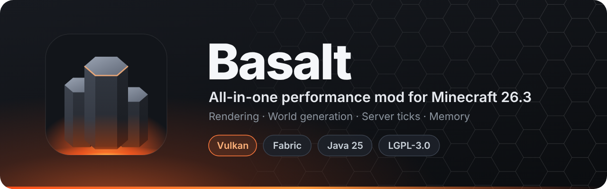

<p align="center">
  
</p>

<p align="center">
  <b>English</b> &nbsp;·&nbsp; <a href="README.ru.md">Русский</a>
</p>

<p align="center">
  
  
  
  
  
</p>

<p align="center">
  <a href="https://github.com/Kolya62/Basalt/releases/latest">
    
  </a>
</p>

<p align="center">
  <a href="#-highlights">Highlights</a> ·
  <a href="#-installation">Installation</a> ·
  <a href="#-features">Features</a> ·
  <a href="#-configuration">Configuration</a> ·
  <a href="#-building">Building</a>
</p>

---

**Basalt** is an all-in-one performance mod for **Minecraft 26.3 on Fabric**, built around the game's
**Vulkan** renderer. It speeds up rendering, world generation and server ticks and trims memory use.
Every optimization is a separate feature that can be switched off on its own.

## ✨ Highlights

<table>
  <tr>
    <td width="50%" valign="top">
      <h3>🎨 Rendering</h3>
      Half-size chunk vertices, per-direction face culling, cached draw lists, GPU Hi-Z occlusion culling
      of chunk sections and culling of entities hidden behind walls.
    </td>
    <td width="50%" valign="top">
      <h3>🌍 World generation</h3>
      The FEATURES stage (trees, ores, decorations) runs in parallel on its own thread pool,
      and terrain noise can run in a native Rust kernel.
    </td>
  </tr>
  <tr>
    <td width="50%" valign="top">
      <h3>⚡ Server ticks</h3>
      Faster collisions, entity lookups, villager POI searches, mob AI and chunk level queries.
    </td>
    <td width="50%" valign="top">
      <h3>🧠 Memory</h3>
      Compact block state tables, shared block shape data and a lightweight per-section threading check.
    </td>
  </tr>
</table>

## 📦 Installation

1. Install [Fabric Loader](https://fabricmc.net/use/) **0.19.5+** for Minecraft **26.3**.
2. Put [Fabric API](https://modrinth.com/mod/fabric-api) and
   `basalt-<version>.jar` from [Releases](https://github.com/Kolya62/Basalt/releases/latest) into your `mods` folder.
3. Start the game with **Java 25**.

> [!NOTE]
> Basalt targets the **Vulkan** renderer and switches the game to it on startup (`force_vulkan`).
> If Vulkan cannot be created, vanilla falls back to OpenGL. If a startup on Vulkan does not finish
> (crash or hang), Basalt stops forcing Vulkan for good.

## 🧩 Features

Every key below can be set to `true` / `false` in the config.

### 🎨 Rendering — client

| Key | What it does |
|:--|:--|
| `compactvertex` | Stores chunk geometry in a 16-byte vertex format instead of vanilla's 28 bytes. |
| `facecull` | Groups chunk faces by direction and skips the groups facing away from the camera. Needs `compactvertex` and `drawcache`. |
| `drawcache` | Caches each chunk mesh's draw data and reuses the previous frame's draw lists while nothing changes. |
| `gpuculling` | Two-phase Hi-Z occlusion culling of chunk sections on the GPU. `auto` turns it on from render distance 24. Needs `drawcache`. |
| `entityculling` | Hides entities and block entities fully behind opaque blocks (ray tests on a background thread). Range: `entityculling.max_distance`. |
| `modelpart` | Faster entity and item models: each cube corner is transformed once, vertices are written in bulk. |
| `textcache` | Reuses the glyph layout of sign text between frames. |
| `tint` | Reuses biome samples between neighbouring blocks when blending grass, foliage and water colours. |
| `presentmode` | Enables `vsync_mode`: `fifo` (default, classic vsync) or `mailbox` (lower latency, renders up to the FPS limit). |
| `swapchain` | Avoids errors and hitches while the window is being resized. |
| `gpuselect` | Picks the GPU by name: `gpu` = part of the device name (e.g. `RTX`, `Radeon`); empty = vanilla choice. |

### 🌍 World generation & server — client and server

| Key | What it does |
|:--|:--|
| `parallelgen` | Runs the FEATURES step in parallel for chunks whose write areas don't overlap. Threads: `parallelgen.threads` (`0` = auto). |
| `nativenoise` | Terrain Perlin noise in a bundled native (Rust) library, checked bit-for-bit against Java at startup. Falls back to Java without it. |
| `collisions` | Faster entity-vs-block collision checks. |
| `entitysections` | Faster lookups of entities near a small box (e.g. mob pushing). |
| `poi` | Skips chunk columns known to have no points of interest (workstations, beds, portals). |
| `brain` | Faster mob AI behaviour iteration. |
| `randomtick` | Skips needless fluid checks during random ticks. |
| `chunklevel` | Caches the last chunk ticking-level lookup. |
| `fastmap` | Block states share one compact property table: less memory, cheap property changes. |
| `statecache` | Computes block face sturdiness lazily and shares identical results. |
| `threaddetect` | Replaces the per-section threading detector with a lightweight flag. |

## 🔧 Configuration

- **File:** `config/basalt.properties`, created on first launch with every option.
- **In game:** *Options → Video Settings* opens Basalt's settings screen.
- **Restart required:** a disabled feature's mixins are not applied at all.
- **Launch overrides:** any option can be set with `-Dbasalt.<key>=<value>`, e.g. `-Dbasalt.parallelgen=false`.

## 🤝 Compatibility

Basalt overlaps with other optimization mods and declares `breaks` on them:

<details>
<summary>Incompatible mods</summary>

Sodium · Embeddium · Nvidium · Lithium · Canary · C2ME · Noisium · FerriteCore · ModernFix ·
ImmediatelyFast · EntityCulling · MoreCulling · BadOptimizations · Starlight · ScalableLux · VMP

</details>

## 🔨 Building

Requires **JDK 25** and **Gradle 9.7+** (Fabric Loom 1.18).

```sh
gradle build
```

The jar is written to `build/libs/`.

**Releases:** pushing a tag `vX.Y.Z` makes GitHub Actions build the mod and publish a release with the jar;
release notes are taken from `docs/releases/vX.Y.Z.md` when it exists.

> [!TIP]
> `gradle.properties` contains `org.gradle.java.home` with the author's local JDK path. On another
> machine, remove that line or point it to your JDK 25.

The native noise library is optional: `gradle buildNatives` builds it from `native/` (not part of this
repository) into `native/dist/`, which is bundled into the jar.

<details>
<summary><b>📊 Benchmarks and verification</b></summary>

- **Client benchmark:** `gradle runClient -Pbench=<label> [-PbenchArgs="-Dbasalt.<key>=false ..."]` joins the
  singleplayer world `bench` (it must exist in `run/saves/`), warms up, records frame times and writes
  `run/basalt-bench/<label>.txt`. Options: `basalt.bench.warmup`, `basalt.bench.duration`, `basalt.bench.edit`
  (blocks changed per frame, a mesh rebuild stress test).
- **World generation benchmark:** `gradle runServer -Pgenbench=<label> [-PgenbenchArgs="..."]` generates an N×N
  chunk square on a fresh world (`basalt.genbench.size`, default 32) and writes `run-server/basalt-genbench/<label>.txt`.
- **Verification:** `-Dbasalt.<feature>.verify=true` compares against vanilla and fails loudly on any difference:
  `collisions`, `entitysections`, `poi`, `nativenoise`, `drawcache`, `modelpart`, `tint`, `statecache`.
- `-PnoBreaks` builds without the `breaks` section, so other optimization mods can be loaded for comparison.

</details>

## 📜 License

Basalt is licensed under the **GNU Lesser General Public License v3.0 only** (`LGPL-3.0-only`).
See [`LICENSE`](LICENSE) (LGPL v3) and [`COPYING`](COPYING) (GPL v3, which the LGPL v3 builds on).
