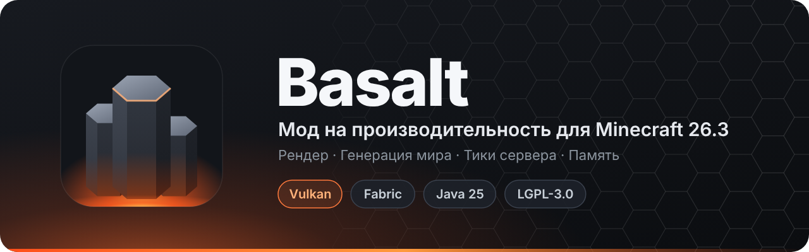

<p align="center">
  
</p>

<p align="center">
  <a href="README.md">English</a> &nbsp;·&nbsp; <b>Русский</b>
</p>

<p align="center">
  
  
  
  
  
</p>

<p align="center">
  <a href="https://github.com/Kolya62/Basalt/raw/main/releases/basalt-0.1.0.jar">
    
  </a>
</p>

<p align="center">
  <a href="#-главное">Главное</a> ·
  <a href="#-установка">Установка</a> ·
  <a href="#-возможности">Возможности</a> ·
  <a href="#-настройка">Настройка</a> ·
  <a href="#-сборка">Сборка</a> ·
  <a href="#-участники">Участники</a>
</p>

---

**Basalt** — мод на производительность «всё в одном» для **Minecraft 26.3 на Fabric**, построенный
вокруг **Vulkan**-рендерера игры. Он ускоряет рендер, генерацию мира и тики сервера и снижает расход памяти.
Каждая оптимизация — отдельная функция, которую можно выключить независимо от остальных.

## ✨ Главное

<table>
  <tr>
    <td width="50%" valign="top">
      <h3>🎨 Рендер</h3>
      Вершины чанков вдвое меньше, отсечение граней по направлению, кэш списков отрисовки,
      Hi-Z окклюзионный куллинг секций чанков на видеокарте и скрытие сущностей за стенами.
    </td>
    <td width="50%" valign="top">
      <h3>🌍 Генерация мира</h3>
      Этап FEATURES (деревья, руды, декорации) выполняется параллельно в собственном пуле потоков,
      а шум рельефа может считаться в нативном ядре на Rust.
    </td>
  </tr>
  <tr>
    <td width="50%" valign="top">
      <h3>⚡ Тики сервера</h3>
      Быстрее столкновения, поиск сущностей, поиск точек интереса жителей, ИИ мобов и запросы уровня чанков.
    </td>
    <td width="50%" valign="top">
      <h3>🧠 Память</h3>
      Компактные таблицы состояний блоков, общие данные форм блоков и лёгкая проверка многопоточности в секциях.
    </td>
  </tr>
</table>

## 📦 Установка

1. Установите [Fabric Loader](https://fabricmc.net/use/) **0.19.5+** для Minecraft **26.3**.
2. Положите [Fabric API](https://modrinth.com/mod/fabric-api) и
   [`basalt-0.1.0.jar`](https://github.com/Kolya62/Basalt/raw/main/releases/basalt-0.1.0.jar) в папку `mods`.
3. Запускайте игру на **Java 25**.

> [!NOTE]
> Basalt рассчитан на **Vulkan**-рендерер и переключает игру на него при запуске (`force_vulkan`).
> Если Vulkan создать не удаётся, ваниль откатывается на OpenGL. Если запуск на Vulkan не завершился
> (краш или зависание), Basalt больше не включает Vulkan принудительно.

## 🧩 Возможности

Каждый ключ ниже можно выставить в `true` / `false` в конфиге.

### 🎨 Рендер — клиент

| Ключ | Что делает |
|:--|:--|
| `compactvertex` | Хранит геометрию чанков в 16-байтовом формате вершины вместо ванильных 28 байт. |
| `facecull` | Группирует грани чанка по направлению и пропускает группы, повёрнутые от камеры. Работает вместе с `compactvertex` и `drawcache`. |
| `drawcache` | Кэширует данные отрисовки каждого меша и переиспользует списки отрисовки прошлого кадра, пока ничего не меняется. |
| `gpuculling` | Двухфазный Hi-Z окклюзионный куллинг секций чанков на видеокарте. `auto` включает его с дальности прорисовки 24. Работает вместе с `drawcache`. |
| `entityculling` | Скрывает сущности и блок-сущности, полностью закрытые непрозрачными блоками (проверка лучами в фоновом потоке). Дальность: `entityculling.max_distance`. |
| `modelpart` | Быстрые модели мобов и предметов: каждый угол куба трансформируется один раз, вершины пишутся пачкой. |
| `textcache` | Переиспользует раскладку глифов текста табличек между кадрами. |
| `tint` | При смешивании цветов травы, листвы и воды переиспользует выборки биомов между соседними блоками. |
| `presentmode` | Включает `vsync_mode`: `fifo` (по умолчанию, классическая вертикальная синхронизация) или `mailbox` (меньше задержка, рендер до лимита FPS). |
| `swapchain` | Убирает ошибки и подвисания при изменении размера окна. |
| `gpuselect` | Выбор видеокарты по имени: `gpu` = часть названия устройства (например, `RTX`, `Radeon`); пусто — выбор ванили. |

### 🌍 Генерация мира и сервер — клиент и сервер

| Ключ | Что делает |
|:--|:--|
| `parallelgen` | Выполняет этап FEATURES параллельно для чанков, чьи области записи не пересекаются. Потоки: `parallelgen.threads` (`0` = авто). |
| `nativenoise` | Перлин-шум рельефа во встроенной нативной (Rust) библиотеке; при запуске побитово сверяется с Java. Без библиотеки используется Java. |
| `collisions` | Быстрая проверка столкновений сущностей с блоками. |
| `entitysections` | Быстрый поиск сущностей рядом с небольшой областью (например, при толкании мобов). |
| `poi` | Пропускает столбцы чанков, в которых точно нет точек интереса (рабочие места, кровати, порталы). |
| `brain` | Быстрый перебор поведений ИИ мобов. |
| `randomtick` | Пропускает лишние проверки жидкостей при случайных тиках. |
| `chunklevel` | Кэширует последний запрос уровня тиков чанка. |
| `fastmap` | Состояния блоков используют одну общую компактную таблицу свойств: меньше памяти, дешёвая смена свойств. |
| `statecache` | Лениво вычисляет «прочность» граней блоков и разделяет одинаковые результаты. |
| `threaddetect` | Заменяет детектор многопоточного доступа в каждой секции лёгким флагом. |

## 🔧 Настройка

- **Файл:** `config/basalt.properties`, создаётся при первом запуске со всеми параметрами.
- **В игре:** *Настройки → Настройки графики* открывают экран настроек Basalt.
- **Нужен перезапуск:** миксины выключенной функции не загружаются вовсе.
- **Параметры запуска:** любой параметр задаётся через `-Dbasalt.<ключ>=<значение>`, например `-Dbasalt.parallelgen=false`.

## 🤝 Совместимость

Basalt пересекается с другими модами на оптимизацию и объявляет для них `breaks`:

<details>
<summary>Несовместимые моды</summary>

Sodium · Embeddium · Nvidium · Lithium · Canary · C2ME · Noisium · FerriteCore · ModernFix ·
ImmediatelyFast · EntityCulling · MoreCulling · BadOptimizations · Starlight · ScalableLux · VMP

</details>

## 🔨 Сборка

Нужны **JDK 25** и **Gradle 9.7+** (Fabric Loom 1.18).

```sh
gradle build
```

Jar появится в `build/libs/`.

> [!TIP]
> В `gradle.properties` указан `org.gradle.java.home` с путём к локальному JDK автора. На другой
> машине удалите эту строку или укажите путь к своему JDK 25.

Нативная библиотека шума необязательна: `gradle buildNatives` собирает её из `native/` (не входит в этот
репозиторий) в `native/dist/`, содержимое которого упаковывается в jar.

<details>
<summary><b>📊 Бенчмарки и проверка</b></summary>

- **Клиентский бенчмарк:** `gradle runClient -Pbench=<метка> [-PbenchArgs="-Dbasalt.<ключ>=false ..."]` заходит в
  одиночный мир `bench` (он должен существовать в `run/saves/`), прогревается, записывает время кадров и пишет
  `run/basalt-bench/<метка>.txt`. Параметры: `basalt.bench.warmup`, `basalt.bench.duration`, `basalt.bench.edit`
  (сколько блоков менять за кадр — стресс-тест перестройки мешей).
- **Бенчмарк генерации мира:** `gradle runServer -Pgenbench=<метка> [-PgenbenchArgs="..."]` генерирует квадрат N×N
  чанков в новом мире (`basalt.genbench.size`, по умолчанию 32) и пишет `run-server/basalt-genbench/<метка>.txt`.
- **Проверка:** `-Dbasalt.<функция>.verify=true` сверяет результат с ванилью и падает при любом расхождении:
  `collisions`, `entitysections`, `poi`, `nativenoise`, `drawcache`, `modelpart`, `tint`, `statecache`.
- `-PnoBreaks` собирает мод без секции `breaks`, чтобы для сравнения можно было загрузить другие моды на оптимизацию.

</details>

## 👥 Участники

<table>
  <tr>
    <td align="center">
      <a href="https://github.com/Kolya62">
        <br>
        <b>Kolya62</b>
      </a><br>
      <sub>Автор</sub>
    </td>
  </tr>
</table>

## 📜 Лицензия

Basalt распространяется под **GNU Lesser General Public License v3.0 only** (`LGPL-3.0-only`).
См. [`LICENSE`](LICENSE) (LGPL v3) и [`COPYING`](COPYING) (GPL v3, на которой основана LGPL v3).
